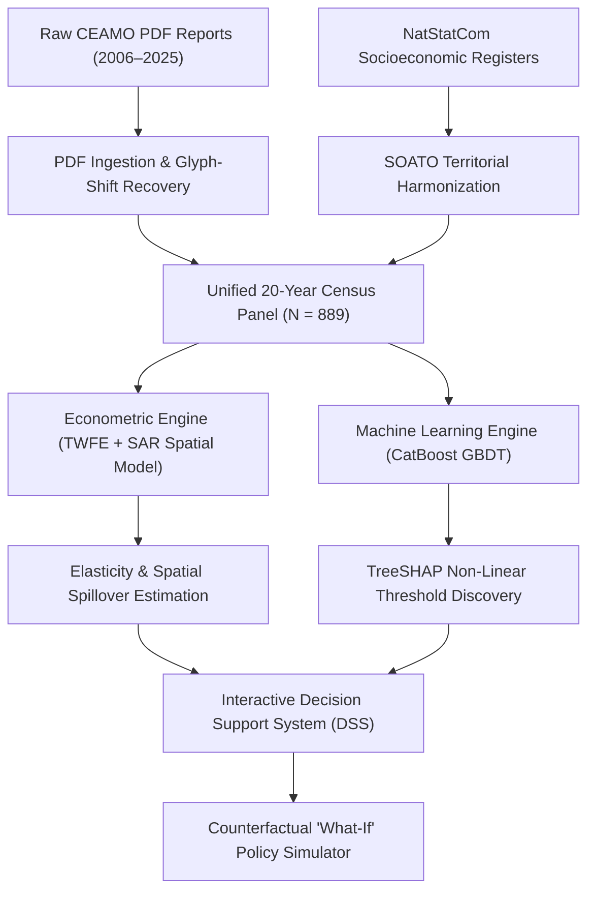

# EduAnalytics-KG: 20-Year Spatio-Temporal Analysis of Kyrgyzstan's National Standardized Testing (ORT 2006–2025)

[](https://www.python.org/downloads/)
[](https://opensource.org/licenses/MIT)
[](data/04_processed/)
[-blue.svg)](data/04_processed/)
[](paper/main.tex)

> **EduAnalytics-KG** is a multi-resolution computational framework and open data ecosystem comprising **12,320 longitudinal and micro-records** analyzing educational inequality, standardized testing (ORT), and academic mobility across the Kyrgyz Republic over two decades (2006–2025).

---

## 📌 Executive Summary

Since its establishment in 2002, the **National Scholarship Testing (*Общереспубликанское тестирование*, ORT)** has served as the sole statutory meritocratic gateway to university admissions and state-funded scholarship allocation (~5,000 full-tuition grants annually) in Kyrgyzstan. Despite a statutory three-tiered affirmative action quota designed to protect rural examinees, stark regional disparities persist:
* **The 23-Point Frozen Divide:** The capital city of Bishkek consistently records average scores exceeding **133 points**, whereas peripheral mountain rayons (Batken, Naryn, mountainous Osh) struggle near **108–112 points**.
* **The 50% Barrier:** In remote districts, over 50% of test-takers fail the mandatory 110-point university qualification cutoff.
* **The Retrospective Reporting Trap:** For two decades, national testing data remained locked in isolated annual PDF reports without longitudinal integration or predictive policy modeling.

**EduAnalytics-KG** unifies two decades of fragmented administrative records into a multi-tier analytical data pipeline: linking testing outcomes with official National Statistical Committee registers (Stat.kg) and school-level microdata (ISUO / data.gov.kg), applying a dual analytical engine (**Two-Way Fixed Effects Panel Econometrics + Spatial Autoregression + Regularized CatBoost GBDT + TreeSHAP Explainable AI**), culminating in an interactive **Decision Support System (DSS)** for counterfactual "What-If" policy simulations.

---

## 🔬 Key Scientific Discoveries

1. **The 18:1 Overcrowding Cliff:** Using TreeSHAP non-linear attribution, we identified a critical structural inflection point in classroom congestion: pupil-teacher ratios between 10:1 and 18:1 maintain steady performance, but exceeding **18:1** causes an immediate, accelerating drop in test scores (-0.85 points per additional pupil).
2. **The 35% Poverty Trap:** District poverty exhibits non-linear acceleration: exceeding a 35% headcount poverty rate induces a sharp penalty of over -4.2 points on average district performance.
3. **Teacher Credentials Outweigh Salary Subsidies:** The proportion of teachers holding tertiary university degrees is the single strongest positive predictor (+2.1 score points), demonstrating that qualification accreditation yields higher educational return than unconditioned salary bonuses.
4. **Counterfactual Budget Optimization:** Decision Support System (DSS) simulations reveal that constructing modular school annexes to cap class sizes at 16:1 in crowded peri-urban belts delivers **double the score gain per som spent** compared to general nominal wage increases.
5. **Persistent Female Meritocratic Premium:** Over a 14-year period (2011–2025), female candidates consistently outscored males by an average of **+8.10 points** and captured **60.94%** of all state budget-funded university scholarships nationwide.

---

## 📂 Multi-Tier Data Ecosystem (12,320 Observations)

EduAnalytics-KG spans six harmonized data tiers covering micro, network, district, and national macro dimensions:

| Tier | Dataset | Observations | Resolution | Features & Description |
| :--- | :--- | :---: | :--- | :--- |
| **Tier 1** | `kg_schools_registry_enriched_2024.csv` | **2,386** | Micro (School) | Complete national school register with OKPO codes, property form, specialized gymnasiums/lyceums flags, and canonical district mapping. |
| **Tier 2** | `ort_district_to_university_flows.csv` | **6,575** | Network (Rayon $\to$ HEI) | Origin-destination academic mobility flows tracking 51,646 grant students across 37 universities over 11 years (2015–2025). |
| **Tier 3** | `ort_complete_panel_enriched_2006_2025.csv` | **889** | Meso (District-Year) | Master longitudinal regression matrix expanded to **38 features** (including NatStatCom 11th grade cohorts, ORT coverage rates, and school infrastructure density). |
| **Tier 4** | `ort_subject_tests_panel_2006_2025.csv` | **243** | Domain (Subject-Year) | 20-year multi-subject panel across 10 disciplines (STEM vs Humanities) and languages of instruction (Kyrgyz, Russian, All). |
| **Tier 5** | `natstatcom_regional_education_panel_2006_2025.csv` | **180** | Macro (Region-Year) | Official NatStatCom 20-year time-series (1990–2025) of cohort graduates, schools, student bodies, and female educators across all 9 regions. |
| **Tier 6** | `ort_gender_gap_panel_2006_2025.csv` | **14** | Disaggregated (Gender-Year) | Longitudinal time-series of female vs. male participation shares, score differentials, and scholarship allocation rates. |
| **Total** | **All Processed Harmonized Data** | **12,320** | **Multi-Tier** | **Full open research data corpus for Kyrgyz educational policy.** |

---

## 📊 Enriched Master Panel Variables (38 Features)

* **Testing Outcomes ($Y$):** `mean_score` (district average [80–245]), `passed_110_count` (examinees $\ge 110$), `pass_rate_pct`, `grant_admitted_count`, `grant_mean_score`.
* **Cohort & Coverage Metrics:** `cohort_graduates_11th` (official 11th grade high school graduates), `regional_ort_coverage_rate_pct` (% taking ORT), `district_est_graduates_cohort`.
* **School Infrastructure (ISUO):** `schools_total_count`, `private_schools_count`, `private_schools_share`, `specialized_schools_count` (gymnasiums/lyceums), `specialized_schools_share`, `boarding_schools_count`.
* **Pedagogical Capacity (NatStatCom):** `pupil_teacher_ratio`, `teachers_higher_ed_pct` (% with university degrees), `students_per_school_reg`, `female_teachers_per_school_reg`.
* **Socioeconomic Environment:** `avg_monthly_salary_som` (KGS), `poverty_rate_pct` (% below poverty line), `rural_population_share`.
* **Topography Flags:** `mountainous_region_flag` (statutory high-altitude $\ge 1,800$m).

---

## 🏗️ Methodological Architecture



### 1. Panel Econometrics
* **Two-Way Fixed Effects (TWFE):**
  $$Y_{it} = \alpha_i + \lambda_t + \mathbf{X}_{it}'\boldsymbol{\beta} + \varepsilon_{it}$$
  Controls for unobserved time-invariant district heterogeneity ($\alpha_i$) and nationwide annual macro shocks ($\lambda_t$).
* **Spatial Autoregressive Model (SAR):**
  $$Y_{it} = \rho \sum_{j=1}^N w_{ij} Y_{jt} + \mathbf{X}_{it}'\boldsymbol{\beta} + \alpha_i + \lambda_t + \varepsilon_{it}$$
  Incorporates a row-standardized contiguity matrix $\mathbf{W}$ to evaluate spatial educational spillovers across neighboring rayons.

### 2. Machine Learning Engine
* **CatBoost GBDT:** Evaluated under a strict **Out-of-Time Temporal Hold-Out Split** (Train: 2006–2021, $N=709$; Test: 2022–2025, $N=180$).
* **Benchmark Performance:** CatBoost achieves **$\text{MAE} = 3.04$** points ($R^2 = 0.74$), significantly outperforming standard OLS ($\text{MAE} = 4.82$, $R^2 = 0.51$).
* **Explainable AI:** Exact Shapley values (TreeSHAP) uncover localized non-linear tipping points.

---

## 📁 Repository Structure

```text
├── data/
│   ├── 01_raw/             # Raw annual CEAMO analytical reports (PDF)
│   ├── 02_extracted/       # Annual structured district tables (CSV)
│   ├── 03_reference/       # SOATO territorial registries & geodata
│   └── 04_processed/       # Complete harmonized panel (2006–2025 CSV & Parquet)
├── notebooks/
│   └── 01_dataset_overview.ipynb  # Interactive exploratory data analysis (EDA)
├── paper/
│   ├── figures/            # 5 publication-grade figures (300 DPI)
│   │   ├── fig1_spatial_map.png
│   │   ├── fig2_longitudinal_trends.png
│   │   ├── fig3_shap_importance.png
│   │   ├── fig4_nonlinear_threshold.png
│   │   └── fig5_whatif_simulation.png
│   ├── main.tex            # Full Master's Thesis Proposal (Draft 2)
│   └── references.bib      # APA 7th academic bibliography
├── src/
│   ├── ingestion/          # PDF text extraction and glyph-shift repair
│   ├── processing/         # Data harmonization, feature engineering
│   └── visualization/      # Spatial maps and SHAP threshold plots
├── EduAnalytics_KG_Draft2_Presentation.pptx  # 10-slide academic presentation
├── EduAnalytics_KG_Presentation_Clean.pptx   # 10-slide clean visual presentation
├── EduAnalytics_KG_Overleaf.zip              # 1-click Overleaf ready archive
├── EduAnalytics_KG_Research_Proposal.docx    # Word proposal document
├── EduAnalytics_KG_project_passport.docx     # Project passport specification
└── requirements.txt        # Python dependency manifest
```

---

## 🚀 Quickstart & Reproduction

### 1. Clone & Set Up Environment
```bash
git clone https://github.com/Aidin2005/ORT_analysis.git
cd ORT_analysis

python3 -m venv .venv
source .venv/bin/activate
pip install -r requirements.txt
```

### 2. Inspect the Panel Dataset
```python
import pandas as pd

df = pd.read_parquet("data/04_processed/ort_complete_panel_2006_2025.parquet")
print(f"Dataset shape: {df.shape}")
print(df[["year", "region_name", "mean_score", "pupil_teacher_ratio", "poverty_rate_pct"]].head())
```

### 3. Compile the Thesis Proposal (Overleaf)
* Upload `EduAnalytics_KG_Overleaf.zip` directly to [Overleaf](https://www.overleaf.com/) for instant LaTeX compilation conforming to Dr. Remudin Reshid Mekuria's academic standard.

---

## 👥 Authors & Academic Context

* **Candidates / Authors:** Aidin Turdukulov & Argen Kulzhanov
* **Degree:** Master of Science in Data Science
* **Department:** Department of Computer Science and Data Science
* **Thesis Adviser:** Dr. Research Supervisor
* **Academic Formatting Standard:** Formatted according to Dr. Remudin Reshid Mekuria's Master's Thesis Proposal syllabus (March 2021 Standard).

---

## 📜 License
This project is open-source under the [MIT License](LICENSE).
Administrative test metrics sourced from official public reports by CEAMO (*ЦООМО*) and the National Statistical Committee of the Kyrgyz Republic (*Нацстатком КР*).
